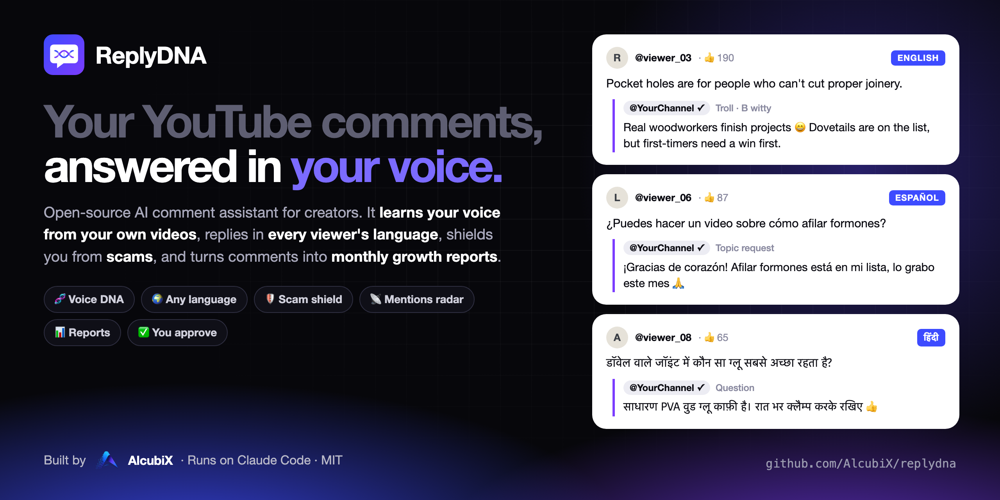
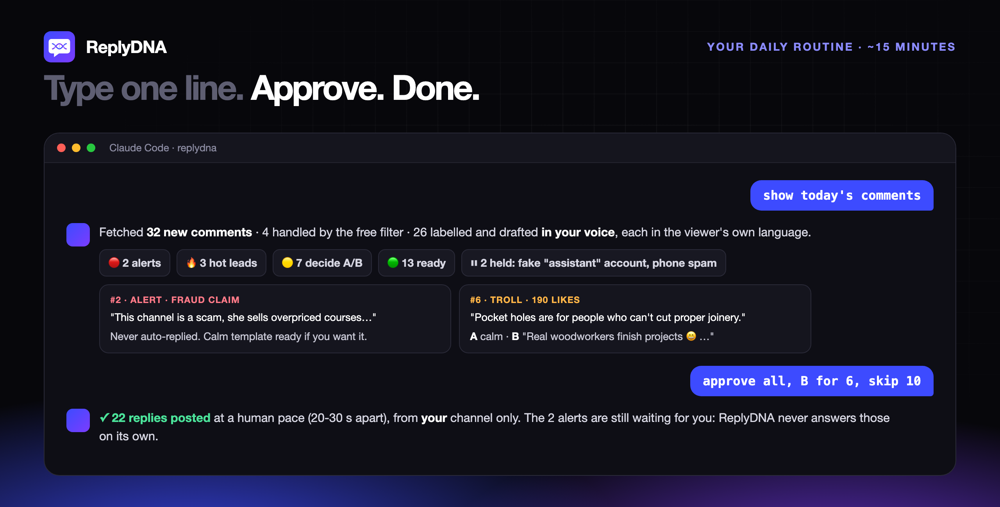
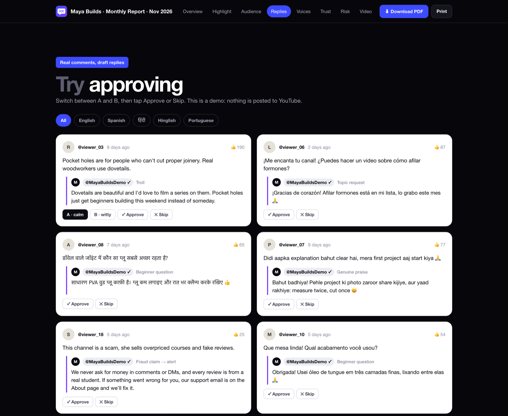
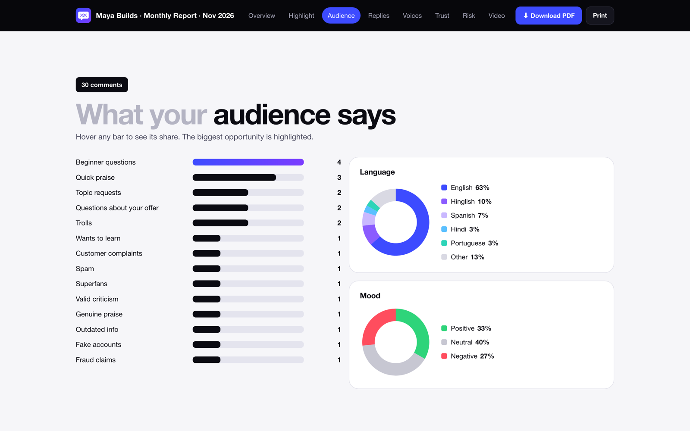
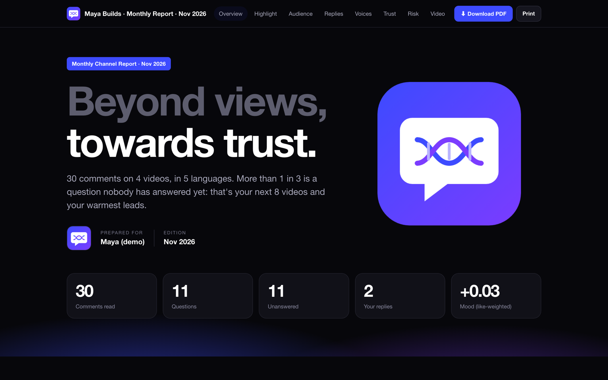
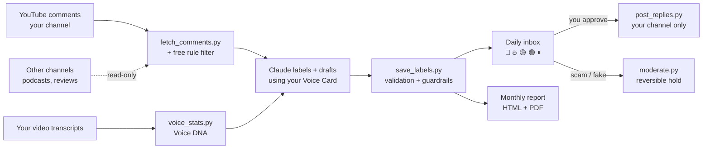
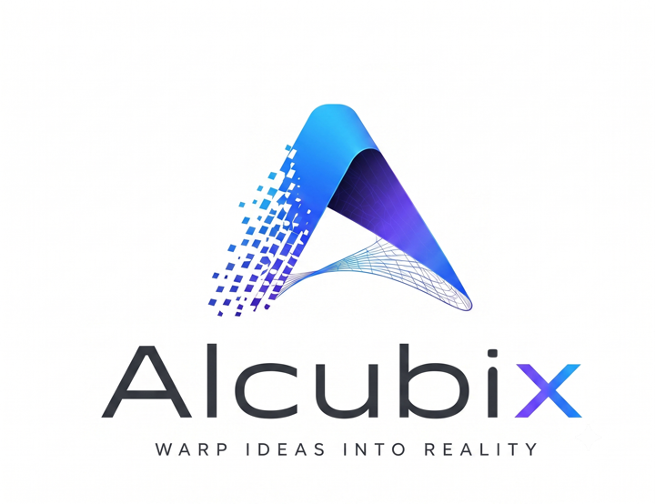

<p align="center">
  
</p>

<h1 align="center">ReplyDNA</h1>

<p align="center">
  <b>The open-source AI comment assistant that replies to your YouTube comments in <i>your</i> voice, in every viewer's language.</b><br>
  Learns how you talk from your own videos · drafts every reply · you approve in 15 minutes a day.
</p>

<p align="center">
  <a href="https://alcubix.github.io/replydna/demo/"><b>▶ Live demo report</b></a> ·
  <a href="#-quick-start">Quick start</a> ·
  <a href="#-how-it-works">How it works</a> ·
  <a href="#-safety-by-design">Safety</a> ·
  <a href="#-faq">FAQ</a>
</p>

<p align="center">
  
  
  
  
</p>

---

## Why

Comments are where your audience tells you what to make next, who wants to buy, who is about to unsubscribe,
and who is pretending to be you to scam your viewers. Most creators can't read them all, and generic AI replies
sound like a bot.

**ReplyDNA reads every comment, writes replies that sound like you, and turns the noise into decisions.**

| Without ReplyDNA | With ReplyDNA |
|---|---|
| Hundreds of unread comments | One inbox a day: alerts, hot leads, A/B decisions, ready replies |
| Generic "Thanks for watching! 🙏" bots | Replies in **your** words, learned from your own transcripts |
| English-only replies | Every comment answered in **its own language and script** (Hinglish → Hinglish, हिंदी → हिंदी, Español → Español …) |
| Trolls get ignored or start fights | Two drafts for every tricky comment: **A** calm · **B** witty. You pick |
| Fake "it's me, DM on Telegram" accounts scam your viewers | Impersonators and scam bots **held automatically** (reversible) |
| You never see what people say about you on other channels | **Mentions radar**: podcasts, reviews and "exposed" videos that mention you |
| Gut feeling | A monthly **interactive report + PDF**: Keep · Improve · Avoid, with evidence |

## ✨ Features

- 🧬 **Voice DNA**: downloads your video captions, measures how you actually talk (address forms, signature phrases, how you open and close) and writes a *voice card* you approve. A blind test checks it: if you can't tell your old replies from its drafts, it's ready.
- 🌍 **Any language, same voice**: replies mirror the commenter's language **and** script, including mixed ones like Hinglish.
- 📥 **15-minute daily inbox**: `🔴 alerts · 🔥 hot leads · 🟡 decide A/B · 🟢 ready · ⏸ held`. Say *"approve all, B for 6, skip 10"* and it's done.
- 🏷️ **28 comment types**: questions, praise, superfans, trolls, valid criticism, "joke but valid", factual corrections, "you're just selling", fraud claims, distress, scams, impersonation and more. Each label comes with evidence, reason and confidence.
- 🛡️ **Scam shield**: holds fake "assistant" accounts, phone-number and Telegram spam (reversible). Copy-pasted fraud claims are grouped, never silently hidden.
- 🔥 **Hot leads, no spam**: your course / product / membership is mentioned only when a viewer asks (pull, never push), capped at 10% of replies, with facts only from a file you confirm.
- 📡 **Mentions radar**: finds other channels' videos about you, reads their comments (read-only), and weights the mood by reach, so one angry 5K-view video doesn't outweigh a 3M-view podcast.
- 📊 **Reports that look like an annual report**: an interactive HTML page (filters, A/B demo, checklist) **plus** a downloadable 16:9 PDF, every month, automatically. [See the live demo →](https://alcubix.github.io/replydna/demo/)
- 🧮 **Honest numbers**: like-weighted mood, Wilson confidence bounds for small samples, a trust scorecard (Ability · Integrity · Benevolence).
- 🔒 **Local first**: your comments, labels and login stay in a SQLite file on your computer. No server, no SaaS.

## 👀 What it looks like

<p align="center"></p>

<table>
<tr>
<td width="50%"></td>
<td width="50%"></td>
</tr>
<tr>
<td align="center"><sub>Draft replies in 5 languages, with A (calm) / B (witty) options</sub></td>
<td align="center"><sub>What your audience says: 28 categories, languages, mood</sub></td>
</tr>
</table>

<p align="center"><br>
<sub>Monthly report, interactive HTML + PDF. <a href="https://alcubix.github.io/replydna/demo/">Open the live demo</a> (fictional channel).</sub></p>

## 🚀 Quick start

**Try the demo in 30 seconds (no YouTube login).** It builds an inbox and a full report from 30 fictional comments in 5 languages:

```bash
git clone https://github.com/AlcubiX/replydna.git && cd replydna
python3 -m venv .venv && .venv/bin/pip install -r requirements.txt
.venv/bin/python scripts/demo.py --open
```

**Use it on your own channel:**

1. Install [Claude Code](https://claude.com/claude-code) (the Claude desktop app's **Code** tab, or the CLI). A Claude Pro or Max plan is enough; no API key needed.
2. Open the `replydna` folder in Claude Code and type **`start`**.
3. Claude interviews you (channel, languages, tone, what you sell), reads your first comments **without any login**, builds your Voice DNA, then walks you through the free YouTube API setup screen by screen ([guide](docs/google-cloud-setup.md)).

That's it. From then on:

| You type | What happens |
|---|---|
| `show today's comments` | fetch → label → draft in your voice → auto-hold scams → your inbox |
| `approve all, B for 6, skip 10` | posts the approved replies, at a human pace, from your channel only |
| `hot leads` | people asking about your course / product, with a one-line summary each |
| `make this month's report` | interactive HTML + PDF report, opened for you |
| `build my voice card` | refreshes your Voice DNA from your latest videos |
| `problem: <any error>` | Claude diagnoses it in one line and fixes it |

## 🧠 How it works



**Claude does the thinking; small Python scripts only move data.** Labels and drafts are written by Claude inside
Claude Code (your subscription), validated by `save_labels.py` (no offer mentions on a troll, alerts can't be
auto-replied, drafts under 500 characters …) and stored in SQLite. Posting and moderation go through the
official YouTube Data API with your own OAuth login.

## 🛡️ Safety by design

- **Draft mode by default.** Nothing is posted, hidden or banned without your OK. The only exception is a *reversible* hold for high-confidence scam / impersonation / personal-info comments.
- **🔴 Alerts are never auto-answered:** fraud claims, distress, legal threats, customer complaints. `approve all` skips them; you approve those one by one.
- **Your channel only.** Every post or moderation call first checks that the logged-in channel is yours. Other channels are strictly read-only.
- **Guardrails you set:** a `never_say` list per niche (no personal financial / medical / legal advice, no guarantees), a disclaimer, a crisis line for distress.
- **Threads end politely:** max 4 assistant replies per conversation, no last-word fights with trolls, no chasing people.
- **Human pace:** 20-30 s between replies, a daily cap, and a quota guard that stops at 9,000 of YouTube's 10,000 free daily units.
- **Your data stays home.** SQLite on your laptop; secrets in `secrets/` (git-ignored). Revoke access any time from your Google account.

## 💸 Cost

| What | Cost |
|---|---|
| ReplyDNA | Free, MIT licensed |
| Claude | Your existing Claude Pro / Max subscription (Claude Code is included) |
| YouTube Data API | Free (10,000 units/day ≈ 180 replies/day) |
| Hosting | None: it runs on your computer |

## 📁 Project structure

```
replydna/
├── CLAUDE.md                  # instructions Claude follows (daily routine, hard rules)
├── config/                    # profile, voice card, playbook, offer facts (examples included)
├── scripts/                   # fetch · label · inbox · post · moderate · mentions · voice DNA · reports · demo
├── templates/report.html      # the interactive report
├── docs/                      # setup protocol, Google Cloud guide, images, live demo
└── examples/demo/             # fictional multilingual dataset used by scripts/demo.py
```

## ❓ FAQ

**Is this against YouTube's rules?** ReplyDNA uses the official YouTube Data API with your own login, posts only what you approve, at a human pace, on your own channel. You stay responsible for what you post, same as typing it yourself.

**Do I need to code?** No. Open the folder in Claude Code and type `start`; Claude does the setup with you step by step. The scripts are there for transparency and for developers.

**Which languages?** Any language Claude can write. The demo shows English, Spanish, Portuguese, Hindi (Devanagari) and Hinglish.

**Can it run fully automatically?** After two weeks in draft mode with ≥ 80% of drafts approved without edits, you can turn on `auto mode` for safe categories only (thanks, simple questions). Alerts and offer mentions always stay manual.

**Does it work on Windows?** Yes: Python 3.10+, Chrome or Edge for PDF reports. Paths in commands use `.venv\Scripts\python` instead of `.venv/bin/python`.

**What about my existing replies?** They are the best training data: the voice card uses your own past replies (`is_owner`) as examples of your written voice.

## 🗺️ Roadmap

- [ ] Optional API mode (scheduled, no laptop needed) with the Batch API
- [ ] Shorts and community-post comments
- [ ] Pinned-comment and heart suggestions in one tap
- [ ] More report languages for the report UI

Ideas and pull requests are welcome. Please open an issue first for big changes.

## 🤝 Built by

<p>
  <a href="https://github.com/AlcubiX">
    <picture>
      <source media="(prefers-color-scheme: dark)" srcset="docs/images/alcubix-logo-dark.png">
      
    </picture>
  </a>
</p>

ReplyDNA is built and maintained by **[AlcubiX](https://github.com/AlcubiX)**: *warp ideas into reality.*
If it saves you time, a ⭐ on the repo helps other creators find it.

<sub>ReplyDNA is an independent open-source project, not affiliated with YouTube, Google or Anthropic. "YouTube" is a trademark of Google LLC; "Claude" is a trademark of Anthropic.</sub>

## License

[MIT](LICENSE) © 2026 AlcubiX
